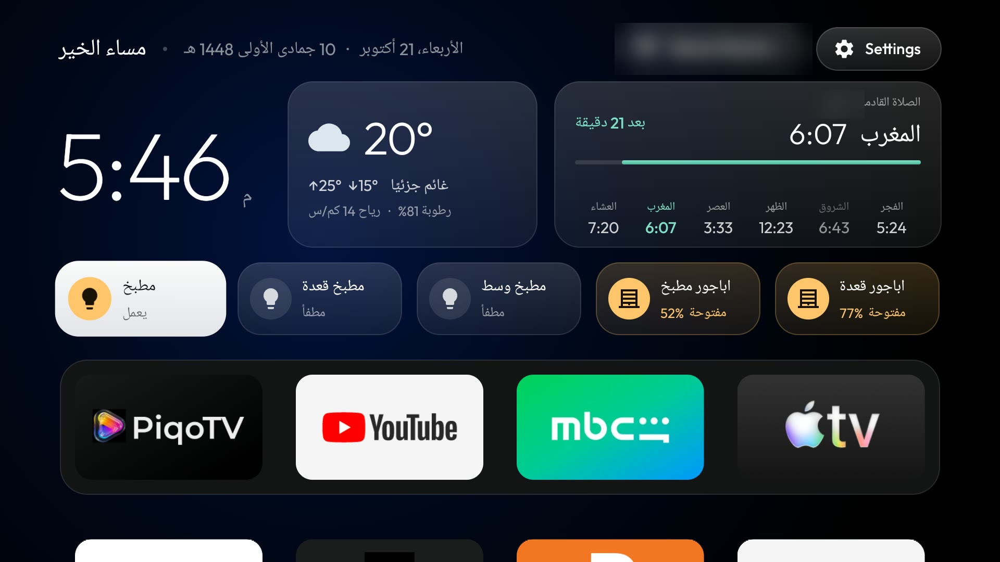
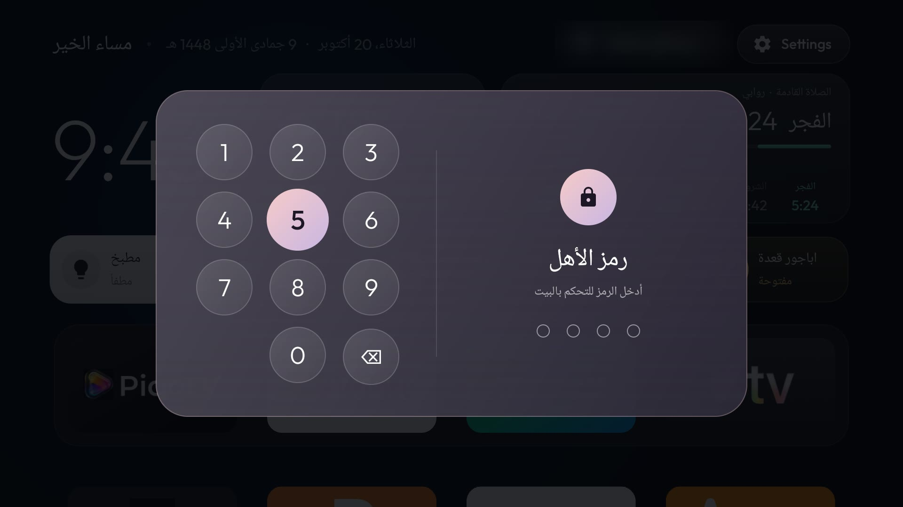
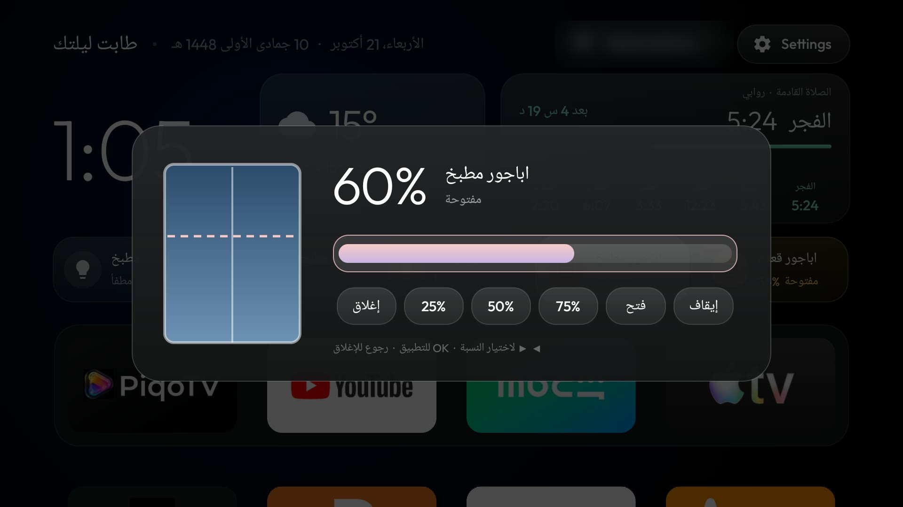
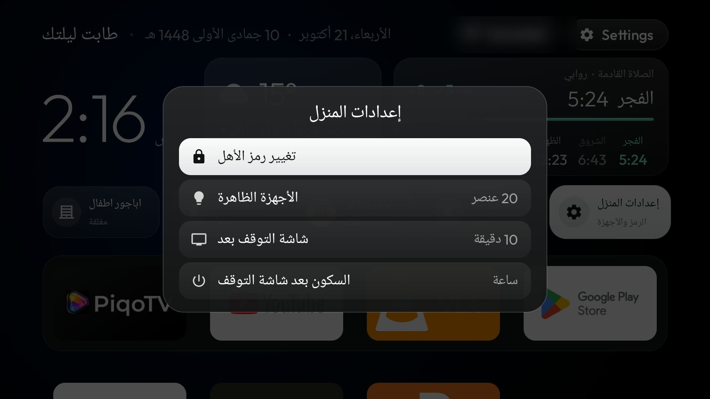
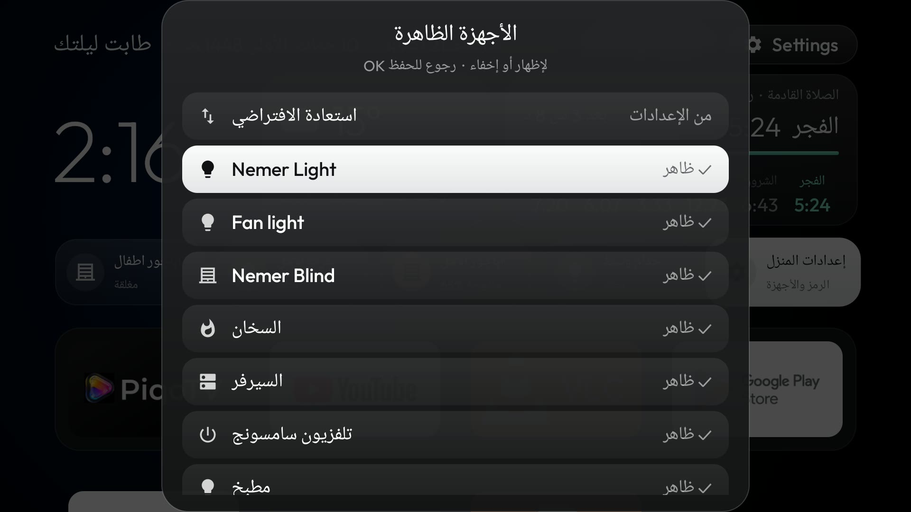

# Home dashboard: prayer times, weather, Home Assistant, kids PIN, adhan, screensaver

This fork turns the top half of the launcher's home screen into a small dashboard. It is still the same light
launcher: plain views and vector icons, no blur, nothing polling in the background. It runs every day on two
boxes: a Bigdroid MBOX (Allwinner, Android 14) and a Xiaomi Mi Box 4 (Android 9, 2 GB).



## What it adds

- **Clock and dates.** A large thin clock, an Arabic greeting, the Gregorian date and the Hijri date (Umm al-Qura).
- **Prayer times, computed on the box.** No internet needed. It uses Meeus' solar formulas as the Adhan library
  does, so times match the common prayer apps to the minute. You can set the method angles and add
  per-prayer offsets in minutes. The card shows the next prayer, a countdown, a progress bar and all six times.
- **Weather.** From Open-Meteo, which is free and needs no key: icon, temperature, high and low, humidity, wind.
  It refreshes at most every 30 minutes, and only while Home is on screen.
- **Home Assistant tiles.** Lights, switches, fans, scripts, buttons and power sensors, with their live state.
  A device that is on glows amber. OK toggles. A group tile can open a panel with more controls; mine shows a
  server's power draw and its AMT scripts.
- **Blinds with a position.** OK on a cover opens a panel: a drawing of the window, the percentage, a slider
  (Left/Right moves 5%) and presets (0/25/50/75/100%, stop). It shows the real position as the blind moves.
- **Kids PIN.** A quartz-glass number pad comes up before any Home Assistant tile works. It submits itself on
  the fourth digit, and the remote's number keys work too. One correct PIN unlocks the tiles for N minutes.
  Five wrong tries pause the pad for 30 seconds.
- **Home settings tile** (behind the PIN): change the PIN on the TV, show or hide any Home Assistant device as a
  tile, and set the screensaver delay and the sleep timer.
- **Adhan.** At Fajr, Dhuhr, Asr, Maghrib and Isha it plays an audio file you put on the box, over whatever app
  is open: a paused video resumes afterwards. An exact alarm fires at the prayer time, wakes a sleeping box, and
  then schedules the next one.
- **Photo screensaver.** Random photos from Lorem Picsum, free and without a key, with a slow zoom, a crossfade
  every 45 seconds and a clock. Android starts it only when nothing keeps the screen on, and videos do.
- **Remote button remaps for buttons the firmware swallows.** `app_redirects` opens another app whenever the
  firmware's own target app comes to the front (Mi Box 4: TV → PiqoTV). `RedirectActivity` answers a dead
  `nflx://` link (Netflix → YouTube).
- **Several boxes, one codebase.** Every folder `launcher/app/src/<box>/` that has a `res/values/config.xml`
  becomes a build flavor (`assemble<Box>Release`) that overrides the main config. Git ignores those folders, so
  your Home Assistant address, devices, PIN and location never get committed.

| | |
|---|---|
|  |  |
|  |  |


## Set it up for your box

1. Create `launcher/app/src/mybox/res/values/config.xml`. Git ignores it. Put in only what you change:

```xml
<resources>
    <bool name="dashboard">true</bool>
    <bool name="dock_title">false</bool>              <!-- the dashboard takes that room -->
    <string name="dash_lat" translatable="false">31.7683</string>
    <string name="dash_lng" translatable="false">35.2137</string>
    <string name="dash_place" translatable="false">القدس</string>
    <integer-array name="prayer_offsets"><item>0</item><item>0</item><item>0</item><item>0</item><item>0</item><item>0</item></integer-array>
    <string name="ha_url" translatable="false">https://homeassistant.local:8123</string>
    <string-array name="ha_items" translatable="false">
        <item>light.living_room</item>
        <item>cover:Kitchen blind|Kitchen</item>   <!-- domain:Friendly name|Label -->
        <item>~boiler</item>                         <!-- every entity whose name contains "boiler" -->
    </string-array>
    <string name="ha_pin" translatable="false">1234</string>
    <bool name="adhan_enabled">true</bool>
</resources>
```

2. Build and install the flavor:
   `./gradlew assembleMyboxRelease`, push the APK and run `pm install -r` (see `launcher/build-and-install.sh`).

3. Put the Home Assistant token on the box yourself. It never goes into the code. Create a long-lived token in
   Home Assistant (Profile → Security), then:

```bash
adb shell 'mkdir -p /sdcard/Android/data/com.gathin.tvhome/files && printf %s "PASTE_TOKEN" > /sdcard/Android/data/com.gathin.tvhome/files/ha_token'
```

   The launcher moves the token into its private storage and deletes that file. To see what entity names it
   found, run `adb logcat -s TvDash`.

4. Adhan (optional): `adb push adhan.mp3 /sdcard/Android/data/com.gathin.tvhome/files/adhan.mp3`. To trim it at
   a natural pause and make it louder, for example:
   `ffmpeg -i in.mp3 -t 36 -af "volume=6dB,afade=t=out:st=35.6:d=0.4" -ac 1 -b:a 64k adhan.mp3`.
   To test it now: `adb shell am broadcast -n com.gathin.tvhome/.Adhan -a com.gathin.tvhome.ADHAN`.

5. Screensaver and sleep (optional). The home settings tile changes these on the TV once the app has the
   permissions:

```bash
adb shell pm grant com.gathin.tvhome android.permission.WRITE_SECURE_SETTINGS
adb shell appops set com.gathin.tvhome WRITE_SETTINGS allow
adb shell settings put secure screensaver_components com.gathin.tvhome/.PhotoDream
adb shell settings put secure screensaver_enabled 1
adb shell settings put secure screensaver_activate_on_sleep 1   # a TV box always counts as "charging"
```

## Notes

- Home Assistant is read once a minute, and only while Home is on screen. Covers support
  `cover.set_cover_position` when Home Assistant reports `supported_features & 4`.
- The firmware on some boxes wipes `enabled_accessibility_services` every time an app starts (my MBOX does).
  `app_redirects` and the key service then can't stay on. `app_keys` still works while Home is in front.
- A large system font scale is fine: tile names shrink to fit instead of being cut off.
- Prayer times: the Muslim World League angles are the default. Above about 48° latitude in summer, Isha at
  17° doesn't exist; this code doesn't apply a high-latitude rule yet.
